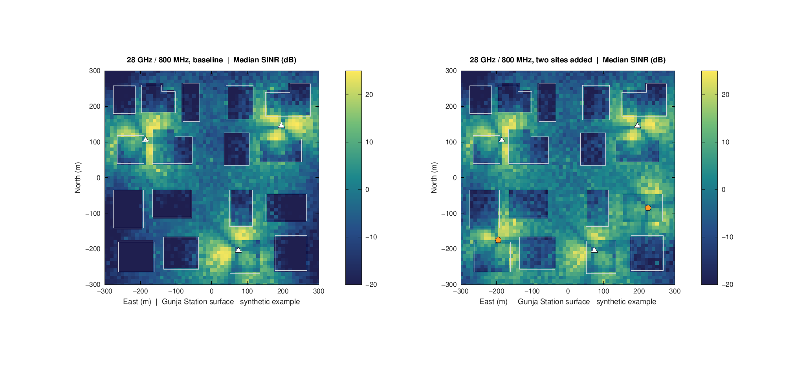
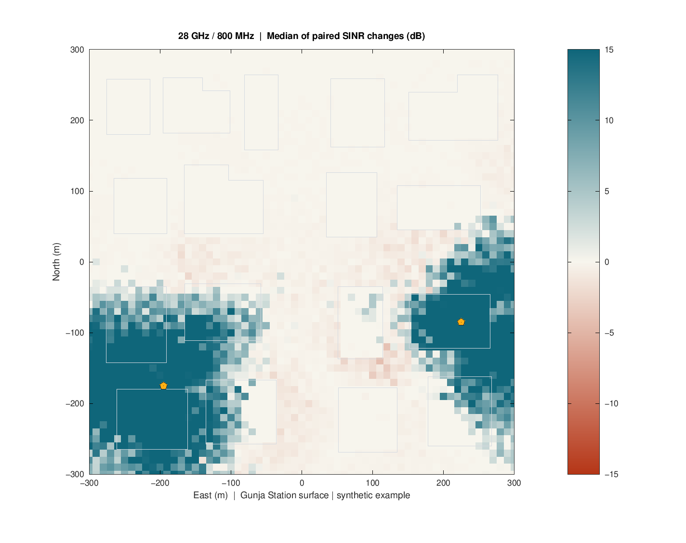
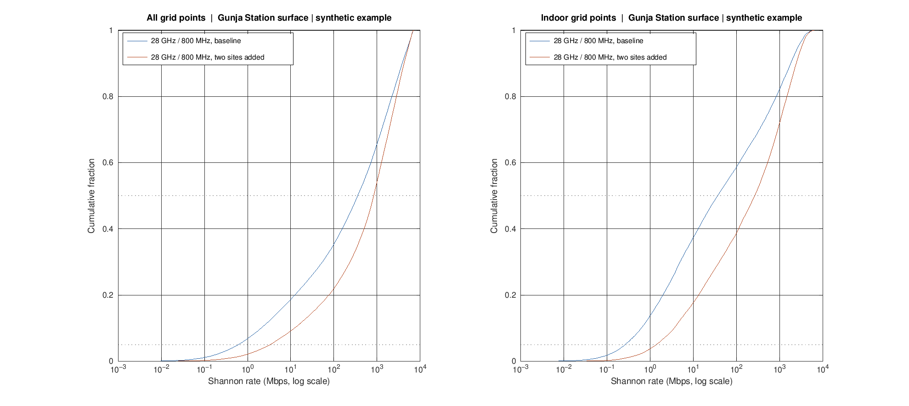
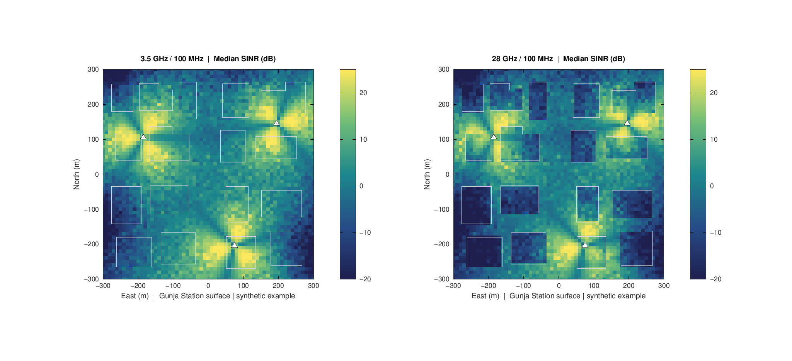
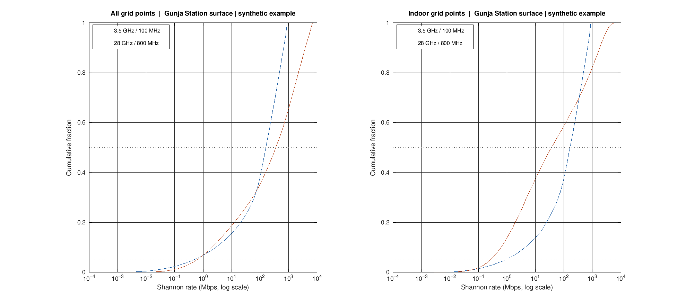
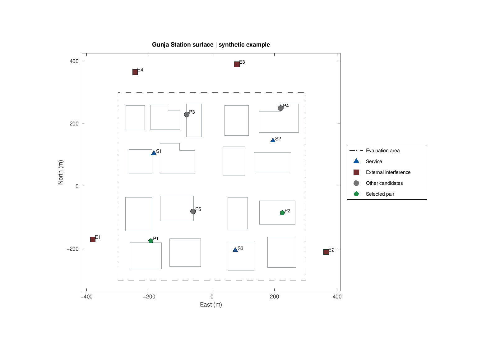

# 4조 MATLAB 코드 실행 결과

저장소의 `main('data/demo')`를 GNU Octave 9.4.0에서 실행했다. 아래 그림 6장은 코드가 저장한 원본이다. 입력은 가상 건물 17개, 기존 서비스 기지국 3곳, 외부 간섭원 4곳이다. 평가는 3,721개 격자점에서 20회씩 수행했다. 군자역 실측 기지국을 이용한 성능은 아직 미확정이다.

## 기지국 두 곳을 추가하면

왼쪽은 기존 배치, 오른쪽은 남서쪽 P1과 남동쪽 P2에 기지국을 추가한 배치다. 노란색에 가까울수록 간섭과 잡음에 비해 수신 신호가 강하다. 오른쪽 지도에서 새 기지국 두 곳 주변이 밝아진다.



| 조건 | 전체 전송률 중앙값 | 전체 전송률 하위 5% 경계 |
| --- | ---: | ---: |
| 3.5 GHz / 100 MHz · 기존 | 158.82 Mbps | 0.46 Mbps |
| 28 GHz / 100 MHz · 기존 | 98.42 Mbps | 0.24 Mbps |
| 28 GHz / 800 MHz · 기존 | 355.85 Mbps | 0.61 Mbps |
| 28 GHz / 800 MHz · 두 곳 추가 | 834.47 Mbps | 3.31 Mbps |

중앙값은 전체 표본의 절반이 그 이하인 값이다. 하위 5% 경계는 가장 느린 쪽의 성능을 살펴보는 데 쓴다. 표의 전송률은 단말 하나가 대역폭 전체를 사용할 때의 이론값이다.

<details>
<summary>증설 전후 차이 지도와 전송률 누적분포 보기</summary>

변화 지도에서 파란 초록색은 수신 품질 상승, 붉은색은 하락이다. 전송률 누적분포에서는 같은 높이에서 오른쪽에 있는 곡선의 전송률이 높다.





</details>

## 주파수와 대역폭을 바꾸면

두 지도 모두 대역폭이 100 MHz다. 3.5 GHz에서 28 GHz로 바꾸면 건물 안의 짙은 남색 영역이 늘어난다. 실내 SINR 중앙값도 3.26 dB에서 −7.02 dB로 낮아졌다.



28 GHz의 대역폭을 800 MHz로 넓힌 경우 전체 전송률 중앙값은 355.85 Mbps다. 전체 중앙값은 3.5 GHz / 100 MHz의 158.82 Mbps를 웃돌지만, 실내 하위 5% 경계는 각각 0.26 Mbps와 0.89 Mbps다.



<details>
<summary>예제에 사용한 건물과 기지국 위치 보기</summary>



</details>

## MATLAB에서 같은 예제 실행하기

1. 저장소에서 녹색 **Code → Download ZIP**을 누르고 압축을 푼다.
2. MATLAB 위쪽의 **현재 폴더(Current Folder)** 를 `main.m` 파일이 보이는 폴더로 바꾼다.
3. **명령 창(Command Window)** 에 아래 한 줄을 붙여 넣고 Enter를 누른다.

```matlab
main('data/demo')
```

실행이 끝나면 MATLAB의 현재 폴더 목록에서 `results → demo → placement_sinr.png`를 더블클릭해 첫 번째 그림을 본다. MATLAB과 Octave의 난수 생성 방식에 따라 수치는 조금 달라질 수 있다.

[전체 통계표](summary.csv) · [각 위치의 계산값](grid_metrics.csv) · [후보 쌍별 점수](placement_scores.csv) · [실행 조건과 난수 시드](run_info.txt)
