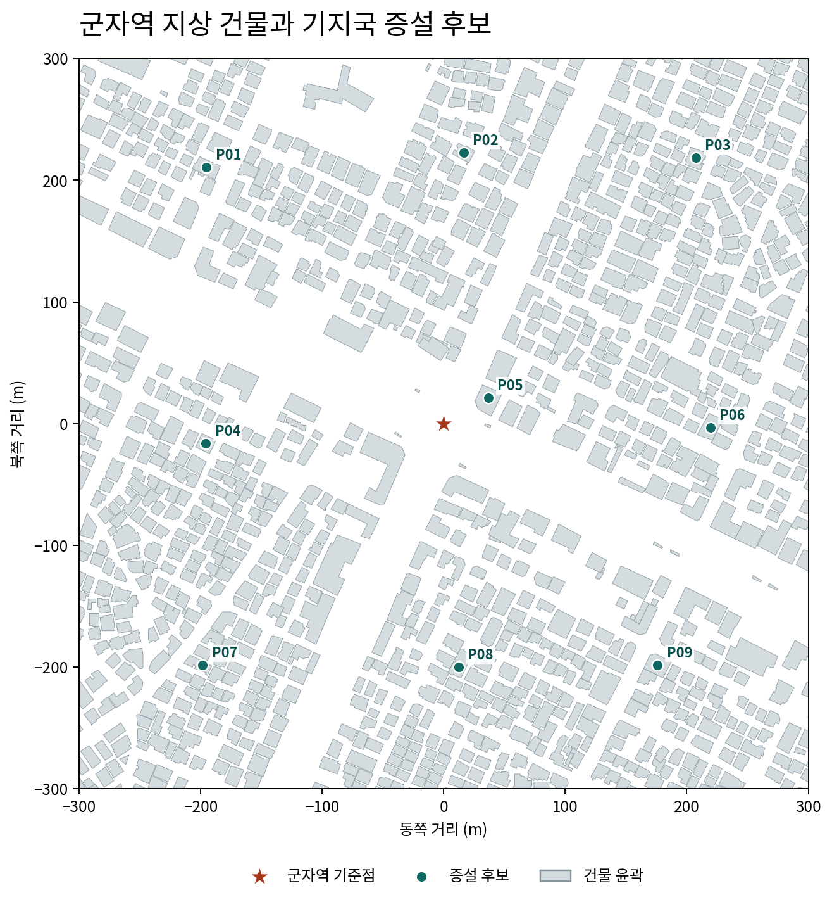

# 군자역 지상 5G 배치 조사

군자역 중심에서 동서·남북으로 각각 300 m까지를 평가한다. 이 구역과 겹치는 서울 건물 윤곽 **1,167개**와 증설 후보 **9곳**의 좌표를 수록했다. 2026년 11월 26일(한국 시간) 전파누리에 직접 접속했으나 클라우드의 HTTPS 연결 단계에서 403이 반환됐다. 현재 공식 기지국 수와 위치, 최종 증설 두 곳, 군자역 SINR과 전송률은 미확정이다.



## 기준점과 건물

| 항목 | 조사값 |
| --- | --- |
| 원점 | 군자역, 북위 37.5572237°, 동경 127.0795184°. 서울 도시철도 GTFS의 역 ID 2545 |
| 좌표계 | WGS84 타원체에서 원점을 기준으로 한 국지 동·북 좌표(m). 높이는 0 m로 두고 평면 위치만 사용 |
| 건물 입력 | 서울 건물 도형 695,900건 중 평가 구역과 면적이 겹치는 다각형 1,167개. 외곽 꼭짓점 7,965개와 안뜰 1개 |
| 구역 내 건물 면적 | 경계에서 자르고 겹침을 한 번만 세면 138,155 m². 평가 면적 360,000 m²의 38.38% |
| 사용자 격자 | 10 m 간격. 총 3,721개 중 실내 1,441개, 실외 2,280개. 외벽 위는 실내, 안뜰 내부는 실외 |

기준점은 Catenary가 배포한 서울 도시철도 GTFS의 `stops.txt`에서 가져왔다. 배포 파일은 갱신되므로 사용한 한 행을 저장소에 보존했다. 해당 시점 `stops.txt`의 SHA-256은 `87e8c205b199e4ae2dd7e082cfb6769af7938b00abd38438e72aea91b3302889`다. OpenStreetMap의 군자역 지점과는 약 4 m 차이가 난다. [저장한 원점](../../data/gunja/origin.csv) · [GTFS 배포본](https://github.com/catenarytransit/seoulmetro-gtfs/releases/download/latest/gtfs.zip) · [OpenStreetMap 대조 지점](https://www.openstreetmap.org/node/6046633861)

건물 출처는 Hanbyul Jo의 서울 건물 GeoParquet 2025년 2월 배포본이다. 배포자는 건물 도형을 WGS84로 변환하고 0.00001° 격자로 반올림했다. 배포자의 서울 건물 나이 지도는 브이월드 건물통합데이터를 출처로 명시한다. 개별 건물의 측량일과 현장 오차는 원본에서 확인할 수 없다. CSV의 소수점 두 자리는 미터 좌표의 저장 자릿수다. [사용한 GeoParquet와 제작 설명](https://github.com/hanbyul-here/seoul-building-sketch-geoparquet/tree/f1f80855b0c81bcd37096db931ba931d6bd002bd) · [배포자의 출처 표기](https://github.com/hanbyul-here/seoul-building-explorer-2024/tree/6b0ee25e4e873354f59c95fae2aa9ccfa4d8ce4e) · [브이월드 건물통합데이터](https://www.vworld.kr/dtmk/dtmk_ntads_s003.do?dsId=30524&fileNo=2)

도형 ID에서 `B` 뒤 숫자는 고정한 원본의 행 번호, 마지막 숫자는 그 행에 들어 있는 다각형의 순번이다. 경계에 걸친 건물도 전체 윤곽을 유지한다. 안뜰과 겹치는 건물까지 고려해 계산한 실내 격자 수는 MATLAB 코드와 독립적인 Python 도형 연산에서 일치했다. [외곽 좌표](../../data/gunja/buildings.csv) · [안뜰 좌표](../../data/gunja/building_holes.csv)

## 기존 기지국 조사 기준

전파누리 ‘이동통신 무선국 찾기’에 군자역 중심과 반경 500 m를 전달한다. 상세 응답에서 SK텔레콤(사업자 번호 542604), 허가 표시 `Y`, 무선국 종별 ‘기지국’, 서비스명에 LTE와 지상 기지국이 표시된 기록을 선택한다. 실내·지하·중계 설비는 제외한다. 한 위치의 여러 허가는 사이트 하나로 묶고 모든 허가 ID와 원본 경·위도를 보존한다. 지도 좌표의 현장 오차와 실제 장비 가동 여부는 별도 확인 대상이다. 사용한 조회 경로는 공개된 전파누리 조회 코드에 근거한다. 서버의 현재 응답 형식은 접속 후 확인해야 한다. [전파누리 군자역 조회](https://spectrummap.kr/gis/mobile_service.json?menuNo=300480&type=&latitude=37.5572237&longitude=127.0795184&zoom=16&visibleRadius=500) · [조회 경로의 출처](https://github.com/n0y0j/ahang-mobile-radio-station/blob/96e56000fabfa3cefb7e091a689ac721fb394c05/lib/browser.js)

600 m 정사각형 안의 위치는 서비스 후보로, 정사각형 밖이면서 원점에서 500 m 이내인 위치는 외부 간섭원으로 사용한다. 조사 반경 밖에서 유입되는 간섭은 모델에서 제외한다. 위치에 가정한 5G 장비는 사이트당 3개 섹터, 방위각 0°·120°·240°, 높이 25 m, 섹터당 송신전력 43 dBm이다. 이 값들은 실제 LTE 장비의 측정값과 별개인 실험 조건이다. [수집 코드](../../src/fetchSpectrumSites.m) · [실험 조건](../../src/simulationConfig.m)

## 증설 후보

평가 구역을 200 m × 200 m 크기의 아홉 칸으로 나눴다. 각 칸에서 평면 면적 150 m² 이상인 건물 중 내부 대표점이 칸 중심과 가장 가까운 도형을 골랐다. 지도에서 각 후보의 건물 ID와 위·경도를 확인할 수 있도록 CSV에 함께 저장했다. 옥상 사용권, 건물 높이와 설치 가능 여부는 현장 조사 대상이다. [후보별 건물·좌표](../../data/gunja/candidates.csv)

전파누리 위치를 확보하면 기존 기지국과 30 m 이상 떨어진 후보만 남긴다. 28 GHz / 800 MHz에서 모든 후보 쌍을 평가해 전체 전송률의 5백분위가 가장 높은 두 곳을 선정하고 별도 난수 시드로 결과를 평가한다. 후보를 추리는 면적·거리 기준과 500 m 조사 반경은 팀의 모델링 가정이다. [실행과 결과표 안내](../../docs/실행방법.md)

## 좌표 재현

수록한 건물·후보 CSV를 이용하는 MATLAB 시뮬레이션에는 Python이 필요하지 않다. 원본부터 다시 추출할 때는 Python 3.11 이상과 NumPy, PyArrow, Shapely 2.1 이상, pyproj를 사용한다. 아래 명령은 저장소 루트에서 실행한다. 추출기는 변환 전에 원본 파일의 SHA-256을 검사한다. 지도 그리기에는 Matplotlib와 한글 글꼴을 사용한다.

```sh
curl -fL https://raw.githubusercontent.com/hanbyul-here/seoul-building-sketch-geoparquet/f1f80855b0c81bcd37096db931ba931d6bd002bd/public/building-arro3.parquet -o /tmp/seoul-buildings.parquet
python tools/prepare_buildings.py /tmp/seoul-buildings.parquet
python tools/plot_survey.py
```
